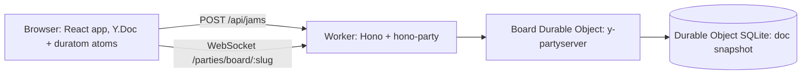

# jambo

A collaborative looper: open a jam, share its link, play a 4×4 pad board and stack loops together in real time. Built on Cloudflare Workers and [duratom](https://github.com/KarolNov/duratom) (Jotai atoms over a Yjs doc).

Live at [jambo.karolnovljakovic.workers.dev](https://jambo.karolnovljakovic.workers.dev). Work in progress: v1 is a multi-track looper with a synthesized sound kit; effects, a timeline and AI-written loops come next.

## How it fits together



- **One Worker** (`worker/index.ts`): Hono serves `/api/*`, routes `/parties/board/:slug` to a `Board` Durable Object through `hono-party`, and serves the React app as static assets.
- **Jams** are links like `/jam/funky-otter-k7q2` (`shared/slug.ts`). The link is the access: anyone who has it can edit. Every board connection passes `onBeforeConnect`, which checks the slug today and is where accounts would be checked later.
- **Board** (`worker/board.ts`): one Durable Object per jam, extending `YServer`. It relays Yjs updates between everyone in the jam and saves a snapshot of the doc to its own storage.
- **Board model and SDK** (`shared/board/`): zod schemas for the jam's tempo, pads and loop tracks; every change is a plain-data operation (`setTempo`, `assignPad`, `addTrack`, `setTrack`, `removeTrack`) applied by `apply(doc, ops, origin)` in one transaction. `board(doc, origin)` is the fluent SDK over it. Nothing else writes to the doc, so the UI, tests and later AI-written code share one validated write path.
- **Looper** (`shared/looper.ts`, `src/audio/`): tracks store pad hits in beats, not audio. Each browser renders the kit (`src/audio/synth.ts`) into buffers and a lookahead scheduler loops every track on its own bar grid; recording counts in one bar, captures hits and rounds the take up to whole bars.
- **Client** (`src/board/`): one `Y.Doc` and one Jotai store per jam, connected with `YProvider`. Components read through duratom atoms (`src/board/model.ts`) and write through the SDK.

## Playing

Tap to start audio, then play pads by clicking or with `1234 / QWER / ASDF / ZXCV`. Space (or Record) starts a one-bar count-in, records what you play, and Space again turns it into a loop for everyone in the jam. Each loop has mute, level and snap (quantize); "Change sounds" reassigns pads for everyone.

## Develop

Needs Node 22+ and pnpm.

```bash
pnpm install
pnpm dev          # Vite + the Worker in workerd, at http://localhost:5173
pnpm test         # Vitest inside the Workers runtime: routes, sync, persistence
pnpm typecheck
pnpm format
```

`pnpm dev` runs the real Worker and Durable Object locally, so two browser tabs on the same jam link sync with each other.

## Deploy

```bash
pnpm deploy       # vite build, then wrangler deploy to workers.dev
```

The first deploy asks Wrangler to log in to your Cloudflare account.

Uploaded sounds live in R2: `jambo-sounds` for production, and `jambo-sounds-preview`, shared by every pull-request preview. Once a PR has merged, clear what its preview uploaded:

```bash
pnpm sounds:clean-preview                                 # dry run: what would go
pnpm sounds:clean-preview --yes                           # empty the preview bucket
pnpm sounds:clean-preview --prefix jams/<slug>/ --yes     # or just one jam
```

It only ever touches the preview bucket named in `wrangler.jsonc`, through Wrangler's remote bindings and your `wrangler login`. Emptying the bucket also clears sounds other open PRs' previews uploaded. It only deletes audio: those previews' jams still list the sounds (they show as missing), and their upload quota still counts the deleted bytes.

## Specs

Specs, blueprints and tasks live in Notion: [Specs & blueprints](https://app.notion.com/p/41b43cce21f281a8aedffc816ffb7b69). `.blueprint/blueprint.json` maps each capability to its code.
