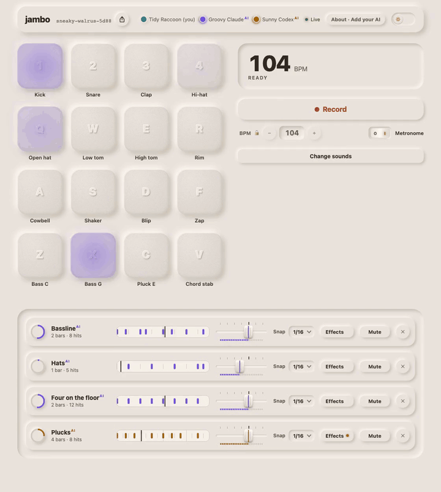
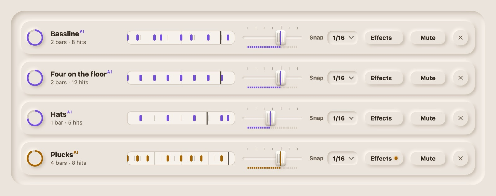
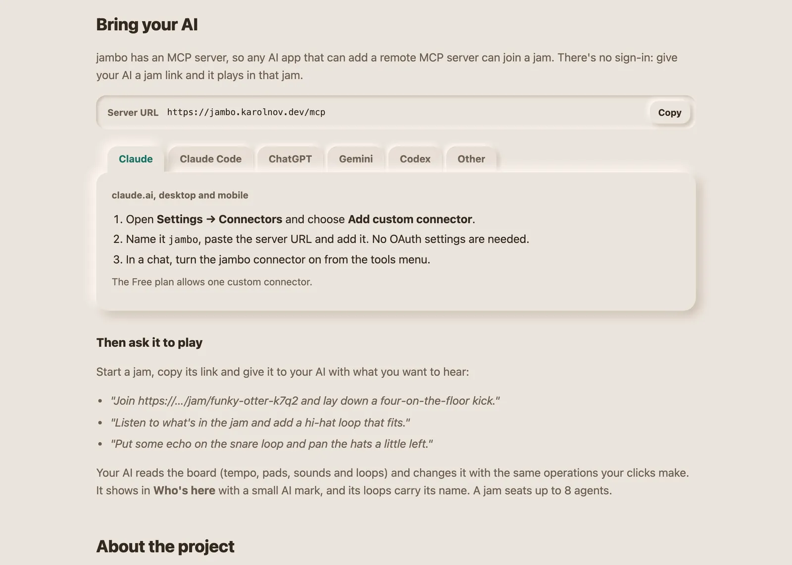
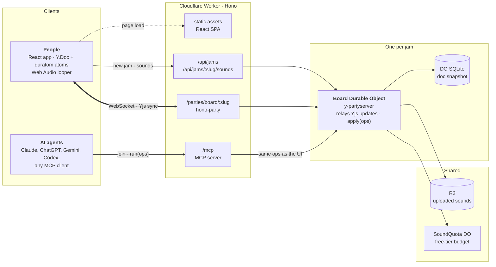

<div align="center">

# jambo

**A collaborative looper you play with friends and AI agents.**<br/>
Open a jam, share the link, and stack loops together in real time.

[**Play now →**](https://jambo.karolnov.dev) &nbsp;·&nbsp; [About & add your AI](https://jambo.karolnov.dev/about) &nbsp;·&nbsp; [Project write-up](https://karolnov.dev/projects/jambo/)

<picture>
  <source media="(prefers-color-scheme: dark)" srcset="docs/media/demo-dark.gif">
  
</picture>

<sub>Four loops from two AI agents are playing, and a new take joins them.</sub>

</div>

## What it is

jambo is a 4×4 pad board you play together. No sign-up: open a jam at [jambo.karolnov.dev](https://jambo.karolnov.dev), send the link, and everyone in it hears and edits the same loops.

- 🥁 **16 pads** with a synthesized kit, or sounds you upload
- 🔁 **A multi-track looper**: record a take, it loops for everyone, on its own bar length
- 🎛️ **Per-loop effects**: reverb, echo, tone, pitch and pan, plus level, mute and snap
- 🤖 **AI agents in the jam**: Claude, ChatGPT, Gemini, Codex or any MCP client can join and play
- ⚡ **Real-time sync** on Cloudflare Workers and Durable Objects, with state in [duratom](https://github.com/KarolNov/duratom) (Jotai atoms over a Yjs doc)

jambo is a side project and changes live.

## Playing

Tap to start audio, then play pads by clicking or with `1234 / QWER / ASDF / ZXCV`. Space (or **Record**) starts a one-bar count-in, records what you play, and Space again turns it into a loop for everyone in the jam. **Change sounds** reassigns pads for everyone, including to sounds you upload.

<picture>
  <source media="(prefers-color-scheme: dark)" srcset="docs/media/loops-dark.jpg">
  
</picture>

Each loop takes its author's colour and has a level fader, snap (quantize), an **Effects** strip and **Mute**.

## Play with an AI agent

jambo has an MCP server, so any AI app that can add a remote MCP server can join a jam. There's no sign-in: give your AI a jam link and it plays in that jam. With Claude Code:

```bash
claude mcp add --transport http jambo https://jambo.karolnov.dev/mcp
```

Then give it a jam link and ask for a beat: _"Join https://jambo.karolnov.dev/jam/funky-otter-k7q2 and lay down a four-on-the-floor kick."_ **[jambo.karolnov.dev/about](https://jambo.karolnov.dev/about#ai)** has the steps for Claude, ChatGPT, Gemini, Codex and other MCP clients.

<picture>
  <source media="(prefers-color-scheme: dark)" srcset="docs/media/about-dark.webp">
  
</picture>

An agent reads the board (tempo, pads, sounds and loops) and changes it with the same operations your clicks make. It shows up in "Who's here" with a small AI mark, and its loops carry its name; a jam seats up to 8 agents. [`skills/jam/SKILL.md`](skills/jam/SKILL.md) is a skill that teaches an agent how to play: copy it into your agent's skills folder to use it as `/jam <link>`.

## How it fits together



- **One Worker** (`worker/index.ts`): Hono serves `/api/*`, routes `/parties/board/:slug` to a `Board` Durable Object through `hono-party`, serves `/mcp`, and serves the React app as static assets.
- **Jams** are links like `/jam/funky-otter-k7q2` (`shared/slug.ts`). The link is the access: anyone who has it can edit. Every board connection passes `onBeforeConnect`, which checks the slug today and is where accounts would be checked later.
- **Board** (`worker/board.ts`): one Durable Object per jam, extending `YServer`. It relays Yjs updates between everyone in the jam and saves a snapshot of the doc to its own storage.
- **Board model and SDK** (`shared/board/`): zod schemas for the jam's tempo, pads, sounds and loop tracks; every change is a plain-data operation (`setTempo`, `assignPad`, `replaceSound`, `addTrack`, `setTrack`, `removeTrack`, `addSound`, `removeSound`, `expireSounds`) applied by `apply(doc, ops, origin)` in one transaction. `board(doc, origin)` is the fluent SDK over it. Nothing else writes to the doc, so the UI, agents and tests share one validated write path.
- **Looper** (`shared/looper.ts`, `src/audio/`): tracks store pad hits in beats, not audio. Each browser renders the kit (`src/audio/synth.ts`) into buffers and a lookahead scheduler loops every track on its own bar grid; recording counts in one bar, captures hits and rounds the take up to whole bars.
- **Sounds** (`worker/sounds.ts`, `worker/quota.ts`): uploaded sounds are stored in R2 per jam; the board doc only lists them. A `SoundQuota` Durable Object keeps uploads inside a share of R2's free tier, and rate limits cap uploads and downloads per address.
- **Agents** (`worker/agent/`, `shared/agent/`): the MCP server at `/mcp` lets AI agents join a jam, read the board and send the same operations people's edits use. Agents show up in "Who's here" next to people.
- **Client** (`src/board/`): one `Y.Doc` and one Jotai store per jam, connected with `YProvider`. Components read through duratom atoms (`src/board/model.ts`) and write through the SDK.

## Develop

Needs Node 22+ and pnpm.

```bash
pnpm install
pnpm dev          # Vite + the Worker in workerd, at http://localhost:5173
pnpm test         # Vitest: the Workers runtime (routes, sync, persistence) and headless Chromium (the UI)
pnpm e2e          # Playwright: real browsers against the local Worker (starts its own on :5199)
pnpm typecheck
pnpm format
```

`pnpm dev` runs the real Worker and Durable Object locally, so two browser tabs on the same jam link sync with each other.

`pnpm e2e` (`e2e/`) is for what needs the whole stack at once: two people in one jam, the jam clock across browsers, a dropped connection merging back, an agent acting over `/mcp`. It runs only against the local Worker: the deployed dev and preview environments sit behind Cloudflare Access, so there are no e2e runs against them for now. It reuses a server already on port 5199 (`E2E_PORT` changes it); a failed run keeps a trace in `test-results/`.

## Deploy

```bash
pnpm deploy       # vite build, then wrangler deploy
```

The first deploy asks Wrangler to log in to your Cloudflare account. To run your own copy, change the R2 bucket names in `wrangler.jsonc` to buckets in your account.

### Pull-request previews

Workers Builds deploys each pull request's branch as a [Preview](https://developers.cloudflare.com/workers/previews/) of the `jambo` Worker (`wrangler preview`, configured by the `previews` block in `wrangler.jsonc`), named after the branch. Each Preview gets its own `Board` and `SoundQuota` Durable Object namespaces, and the Workers Free plan allows 100 namespaces per account, so closed PRs' Previews have to go.

[`preview-cleanup.yml`](.github/workflows/preview-cleanup.yml) does that: when a PR is merged or closed, it deletes that PR's Preview with `wrangler preview delete`, which also deletes its deployments, Durable Object namespaces and their storage. If the Preview doesn't exist, it does nothing. To clean up after a PR by hand, run the workflow from the Actions tab (**Preview cleanup** > **Run workflow**) with the PR number, or:

```bash
gh workflow run preview-cleanup.yml -f pr=<number>
```

It needs two repository secrets: `CLOUDFLARE_ACCOUNT_ID`, and `CLOUDFLARE_API_TOKEN`, an [account-owned API token](https://developers.cloudflare.com/workers/authorization/#use-granular-permissions-with-wrangler) with the Workers **Editor** role scoped to the `jambo` Worker.

Uploaded sounds live in R2: `jambo-sounds` for production, and `jambo-sounds-preview`, shared by every pull-request preview. The cleanup workflow leaves them alone: sounds are stored under `jams/<slug>/`, and a Preview's jam slugs live only in its own Durable Objects, which are gone once it's deleted, so nothing ties a sound to the PR that uploaded it. Clear them by hand, ideally when no other PR's preview is in use:

```bash
pnpm sounds:clean-preview                                 # dry run: what would go
pnpm sounds:clean-preview --yes                           # empty the preview bucket
pnpm sounds:clean-preview --prefix jams/<slug>/ --yes     # or just one jam
```

It only ever touches the preview bucket named in `wrangler.jsonc`, through Wrangler's remote bindings and your `wrangler login`. Emptying the bucket also clears sounds other open PRs' previews uploaded. It only deletes audio: those previews' jams still list the sounds (they show as missing), and their upload quota still counts the deleted bytes.

## Specs and blueprints

jambo is built with [blueprint](https://github.com/KarolNov/skills#blueprint), a set of Claude Code skills from [KarolNov/skills](https://github.com/KarolNov/skills): each capability has a spec, larger changes start as a blueprint (a brief for agents and a visual review for people), and `/blueprint-drift` and `/blueprint-sync` keep the specs and the code in step. The skills repo explains how it works.

Here the specs, blueprints and tasks live in Notion ([Specs & blueprints](https://app.notion.com/p/41b43cce21f281a8aedffc816ffb7b69)). Those pages are private, so that link and the Notion links in `.blueprint/` won't open for everyone. What is in the repo is `.blueprint/`: the map from each capability to its code, and the spec text as of its last sync.

## License

[MIT](LICENSE)
