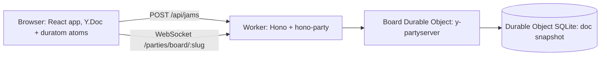

# jambo

A collaborative looper: open a jam, share its link, play a 4×4 pad board and stack loops together in real time, with people and AI agents in the same jam. Built on Cloudflare Workers and [duratom](https://github.com/KarolNov/duratom) (Jotai atoms over a Yjs doc).

**Try it at [jambo.karolnov.dev](https://jambo.karolnov.dev).** No sign-up: open a jam and send the link to whoever you want to play with.

jambo is a side project and changes live. What works today: a synthesized sound kit, your own uploaded sounds, a multi-track looper with per-loop effects, and AI agents that join a jam over MCP. A timeline for arranging loops is still to come.

## How it fits together



- **One Worker** (`worker/index.ts`): Hono serves `/api/*`, routes `/parties/board/:slug` to a `Board` Durable Object through `hono-party`, and serves the React app as static assets.
- **Jams** are links like `/jam/funky-otter-k7q2` (`shared/slug.ts`). The link is the access: anyone who has it can edit. Every board connection passes `onBeforeConnect`, which checks the slug today and is where accounts would be checked later.
- **Board** (`worker/board.ts`): one Durable Object per jam, extending `YServer`. It relays Yjs updates between everyone in the jam and saves a snapshot of the doc to its own storage.
- **Board model and SDK** (`shared/board/`): zod schemas for the jam's tempo, pads, sounds and loop tracks; every change is a plain-data operation (`setTempo`, `assignPad`, `replaceSound`, `addTrack`, `setTrack`, `removeTrack`, `addSound`, `removeSound`) applied by `apply(doc, ops, origin)` in one transaction. `board(doc, origin)` is the fluent SDK over it. Nothing else writes to the doc, so the UI, tests and later AI-written code share one validated write path.
- **Looper** (`shared/looper.ts`, `src/audio/`): tracks store pad hits in beats, not audio. Each browser renders the kit (`src/audio/synth.ts`) into buffers and a lookahead scheduler loops every track on its own bar grid; recording counts in one bar, captures hits and rounds the take up to whole bars.
- **Sounds** (`worker/sounds.ts`, `worker/quota.ts`): uploaded sounds are stored in R2 per jam; the board doc only lists them. A `SoundQuota` Durable Object keeps uploads inside a share of R2's free tier, and rate limits cap uploads and downloads per address.
- **Agents** (`worker/agent/`, `shared/agent/`): an MCP server at `/mcp` lets AI agents join a jam, read the board and send the same operations people's edits use. Agents show up in "Who's here" next to people.
- **Client** (`src/board/`): one `Y.Doc` and one Jotai store per jam, connected with `YProvider`. Components read through duratom atoms (`src/board/model.ts`) and write through the SDK.

## Playing

Tap to start audio, then play pads by clicking or with `1234 / QWER / ASDF / ZXCV`. Space (or Record) starts a one-bar count-in, records what you play, and Space again turns it into a loop for everyone in the jam. Each loop has mute, level, snap (quantize) and an Effects strip (reverb, echo, tone, pitch, pan); "Change sounds" reassigns pads for everyone, including to sounds you upload.

## Play with an AI agent

Any MCP client can join a jam. With Claude Code:

```bash
claude mcp add --transport http jambo https://jambo.karolnov.dev/mcp
```

Then give it a jam link and ask for a beat. [jambo.karolnov.dev/about](https://jambo.karolnov.dev/about#ai) has the steps for Claude, ChatGPT, Gemini, Codex and other MCP clients. [`skills/jam/SKILL.md`](skills/jam/SKILL.md) is a skill that teaches an agent how to play; copy it into your agent's skills folder to use it as `/jam <link>`. The jam link is the only key, for agents as for people.

## Develop

Needs Node 22+ and pnpm.

```bash
pnpm install
pnpm dev          # Vite + the Worker in workerd, at http://localhost:5173
pnpm test         # Vitest inside the Workers runtime: routes, sync, persistence
pnpm typecheck
pnpm format
```

`pnpm dev` runs the real Worker and Durable Object locally, so two browser tabs on the same jam link sync with each other.

## Deploy

```bash
pnpm deploy       # vite build, then wrangler deploy
```

The first deploy asks Wrangler to log in to your Cloudflare account. To run your own copy, change the R2 bucket names in `wrangler.jsonc` to buckets in your account.

Uploaded sounds live in R2: `jambo-sounds` for production, and `jambo-sounds-preview`, shared by every pull-request preview. Once a PR has merged, clear what its preview uploaded:

```bash
pnpm sounds:clean-preview                                 # dry run: what would go
pnpm sounds:clean-preview --yes                           # empty the preview bucket
pnpm sounds:clean-preview --prefix jams/<slug>/ --yes     # or just one jam
```

It only ever touches the preview bucket named in `wrangler.jsonc`, through Wrangler's remote bindings and your `wrangler login`. Emptying the bucket also clears sounds other open PRs' previews uploaded. It only deletes audio: those previews' jams still list the sounds (they show as missing), and their upload quota still counts the deleted bytes.

## Specs and blueprints

jambo is built with [blueprint](https://github.com/KarolNov/skills#blueprint), a set of Claude Code skills from [KarolNov/skills](https://github.com/KarolNov/skills): each capability has a spec, larger changes start as a blueprint (a brief for agents and a visual review for people), and `/blueprint-drift` and `/blueprint-sync` keep the specs and the code in step. The skills repo explains how it works.

Here the specs, blueprints and tasks live in Notion ([Specs & blueprints](https://app.notion.com/p/41b43cce21f281a8aedffc816ffb7b69)). Those pages are private, so that link and the Notion links in `.blueprint/` won't open for everyone. What is in the repo is `.blueprint/`: the map from each capability to its code, and the spec text as of its last sync.

## License

[MIT](LICENSE)
