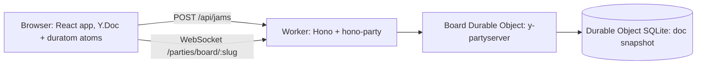

# jambo

A collaborative music board: open a jam, share its link, and arrange tracks together in real time. Built on Cloudflare Workers and [duratom](https://github.com/KarolNov/duratom) (Jotai atoms over a Yjs doc).

Work in progress. The scaffold syncs a list of named tracks; clips, audio, presence and export come next.

## How it fits together



- **One Worker** (`worker/index.ts`): Hono serves `/api/*`, routes `/parties/board/:slug` to a `Board` Durable Object through `hono-party`, and serves the React app as static assets.
- **Jams** are links like `/jam/funky-otter-k7q2` (`shared/slug.ts`). The link is the access: anyone who has it can edit. Every board connection passes `onBeforeConnect`, which checks the slug today and is where accounts would be checked later.
- **Board** (`worker/board.ts`): one Durable Object per jam, extending `YServer`. It relays Yjs updates between everyone in the jam and saves a snapshot of the doc to its own storage.
- **Client** (`src/board/`): one `Y.Doc` and one Jotai store per jam, the doc in duratom's `docAtom`, connected with `YProvider`. Components read and write the doc only through duratom atoms; `src/board/model.ts` holds the schemas.

## Develop

Needs Node 22+ and pnpm.

```bash
pnpm install
pnpm dev          # Vite + the Worker in workerd, at http://localhost:5173
pnpm test         # Vitest inside the Workers runtime: routes, sync, persistence
pnpm typecheck
pnpm format
```

`pnpm dev` runs the real Worker and Durable Object locally, so two browser tabs on the same jam link sync with each other.

## Deploy

```bash
pnpm deploy       # vite build, then wrangler deploy to workers.dev
```

The first deploy asks Wrangler to log in to your Cloudflare account.

## Specs

Specs, blueprints and tasks live in Notion: [Specs & blueprints](https://app.notion.com/p/41b43cce21f281a8aedffc816ffb7b69). `.blueprint/blueprint.json` maps each capability to its code.
